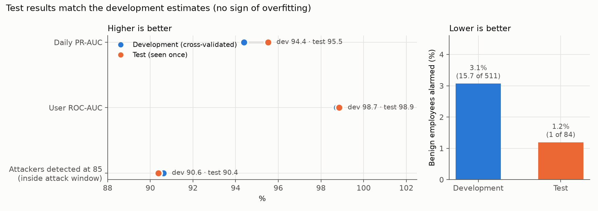
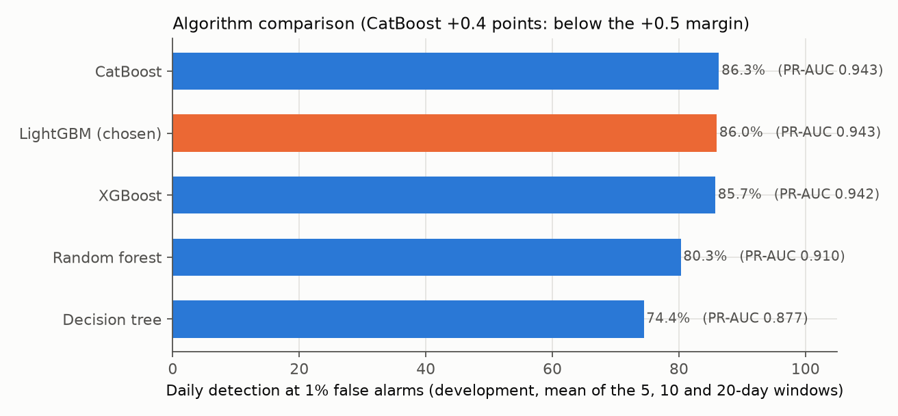
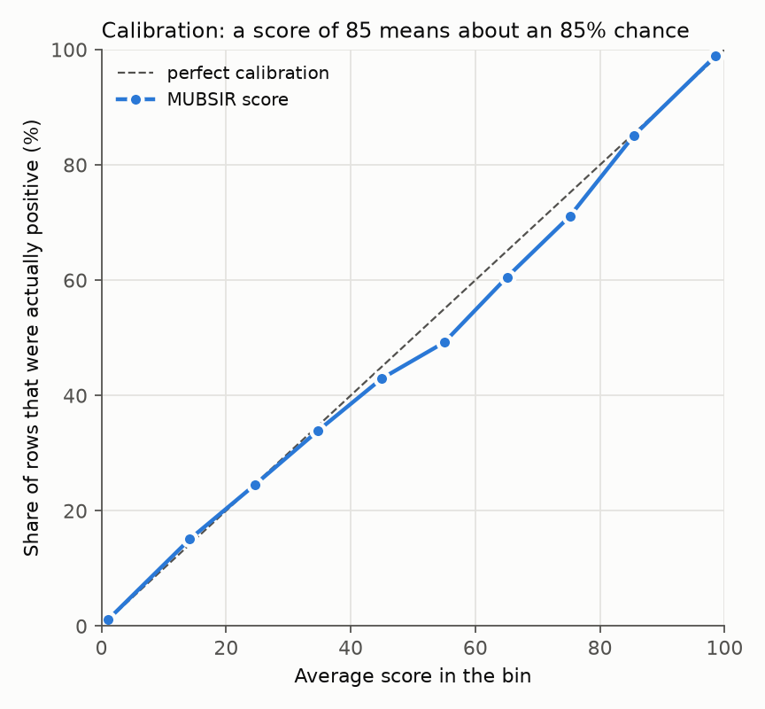
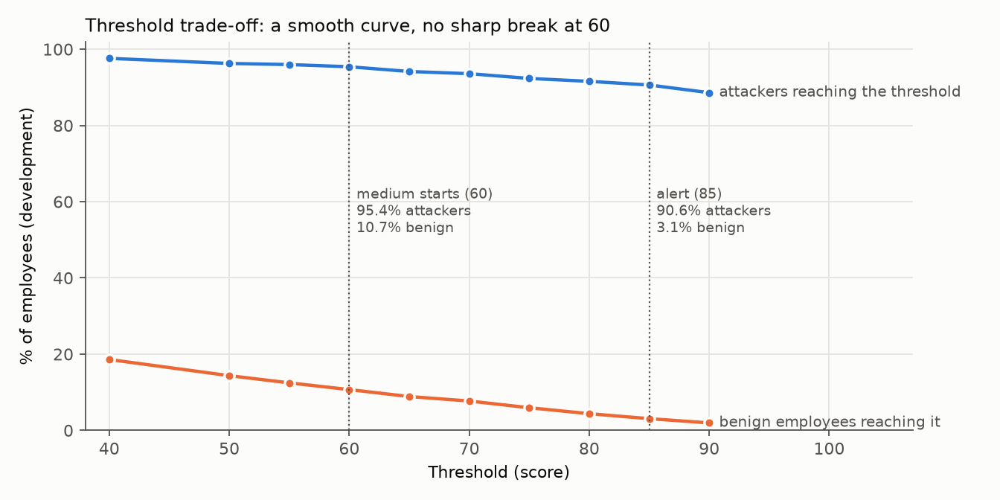
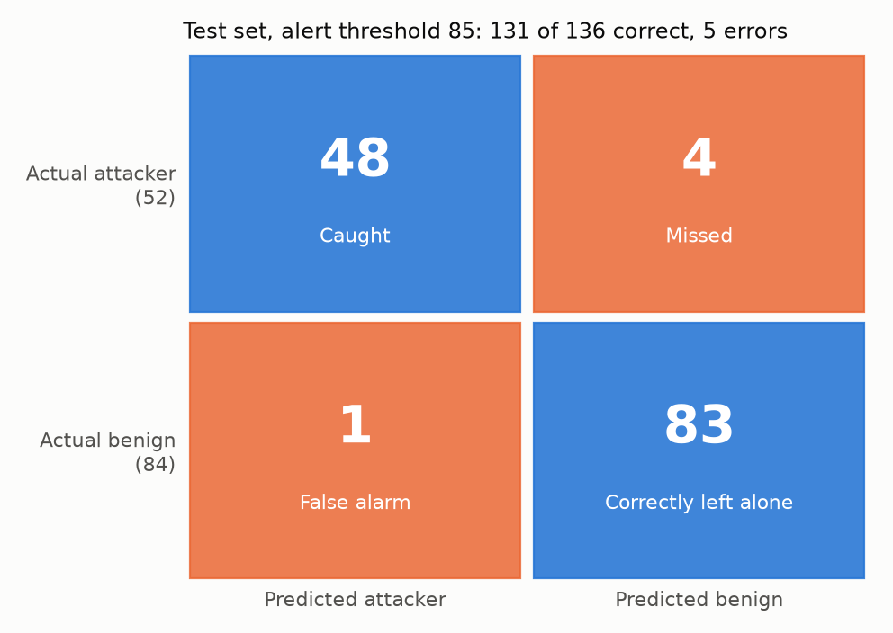
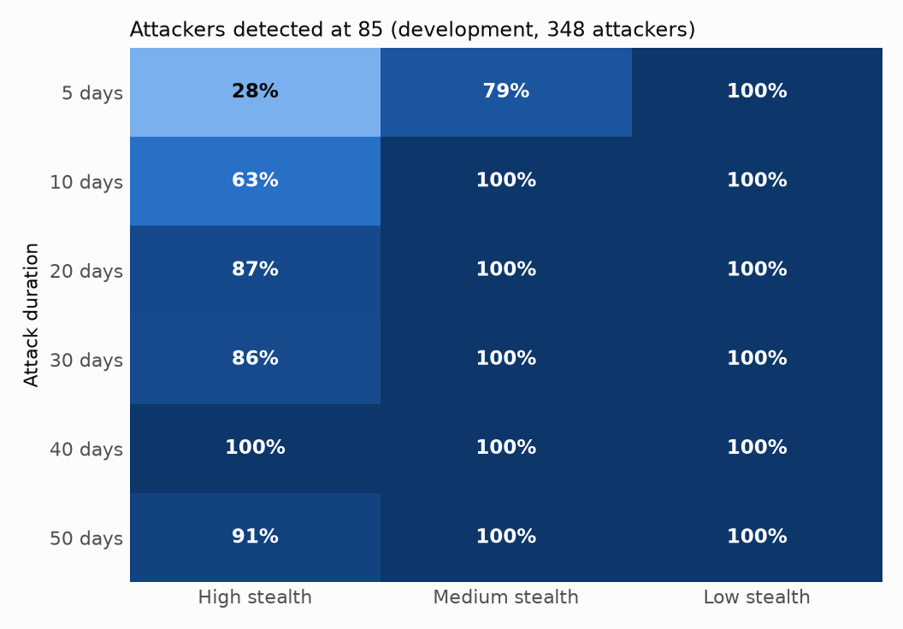
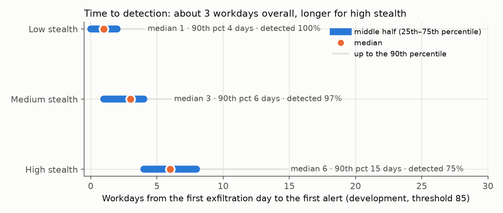
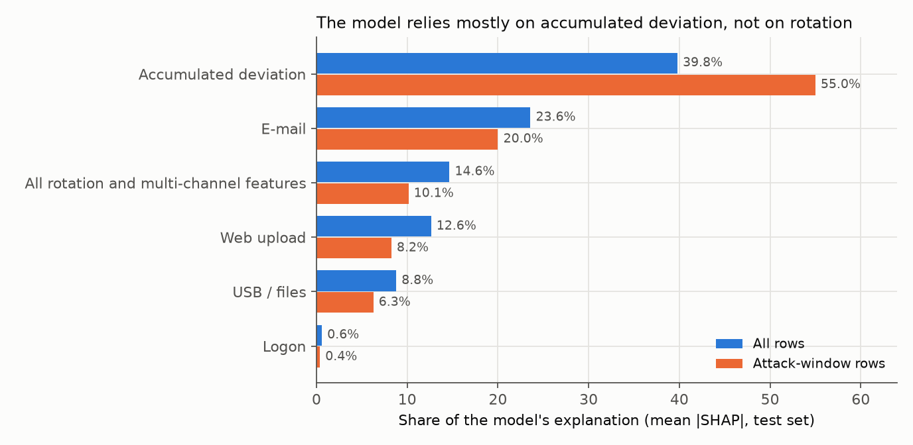
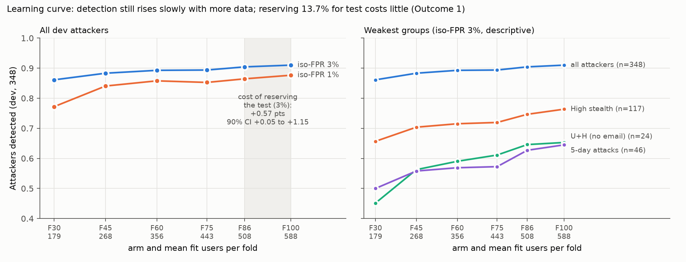

# MUBSIR Model v2: Final Detailed Report

**Training and evaluation of the MUBSIR model on the new dataset.**
First issued 2026-11-24. Updated 2026-11-28 with the post-freeze studies and corrections.

One LightGBM model was trained on 859 multi-channel employees. On the locked test set it flagged **48 of 52 attackers
with one false alarm out of 84 benign employees**; 47 of the 48 were flagged inside their attack window. The median time
to detection is 3 workdays from the first exfiltration day. The results agree with the development estimates. The clear
weakness is short, high-stealth attacks.

---

## 1. Key results

Test performance (136 employees the model never saw) matches the development estimates obtained by cross-validation on
859 employees.

| Measure | Test | 95% CI (test) | Development estimate |
|---|---|---|---|
| Daily PR-AUC (10-workday label) | 0.955 | 0.931–0.973 | 0.944 |
| User ROC-AUC (highest daily score per employee) | 0.989 | 0.968–0.999 | 0.987 |
| Attackers detected inside their attack window at the alert threshold (score > 85) | 47 / 52 (90.4%) | 79–97% | 90.6% |
| Attackers flagged at any time (employee-level decision) | 48 / 52 (92.3%) | 81.5–97.9% | — |
| Benign employees wrongly alarmed at 85 | 1 / 84 (1.2%) | 0–6.5% | 3.1% (15.7 of 511) |
| Median / 90th percentile time to detection (workdays) | 3 / 9 | — | 3 / 8 |
| Calibration: average predicted vs observed rate | 0.1326 / 0.1328 | — | 0.1355 / 0.1354 |

- **False alarms:** the most reliable false-alarm estimate is the development one (3.1%), because the test set has only
  84 benign employees.
- **Test opened once:** the test set was opened a single time, after the model, the calibration and the thresholds were
  frozen. No decision was taken on its results.

---

## 2. Data and scope

**Scope:** **995 multi-channel employees**, meaning employees with USB or web-upload history in 2010.
- 400 simulated attackers and 595 benign employees.
- Workdays from January to June 2011: 103,395 employee-days.
- Source: the team's feature file `behavior_features_r62_ml_final_new.parquet`. It was read only, never modified.

| Part | Attackers | Benign | Total | Employee-days |
|---|---:|---:|---:|---:|
| Development | 348 | 511 | 859 (86.3%) | 89,471 |
| Test | 52 | 84 | 136 (13.7%) | 13,924 |

**Features: 100.** The delivered file has 143 columns.

| Decision | Columns | Reason |
|---|---:|---|
| Kept | 97 | Behavioural features |
| Removed | 8 | Identifiers, dates and constant columns |
| Removed | 15 | Fields the attack injection did not update (distinct files, distinct domains and recipients, bytes). They would reveal attacks through a simulation flaw rather than through behaviour. Adding them back inflates attacker detection by 3.5 points (measured in an ablation) |
| Removed | 23 | Raw 2010 profile columns that reveal "who the employee is" instead of "what they did". Their values are still used inside the deviation features |
| Added | 3 | `E_email_today`, `E_usb_today`, `E_http_today`: how far each channel is above the employee's own normal today |

**Label:** a day is positive if the employee had at least one exfiltration day in the last 10 workdays, the current day
included.
- **Backward-looking only:** the label never uses a future attack day, and this was checked.
- **Positive rate:** 13.5% of days.
- **Rest days are handled:** an attacker's rest days inside the attack window are a problem for a same-day label. With
  this label, 96% of them become positive, because an attack happened 4 or fewer days before.

Full dataset audit: `reports/dataset_audit.md`.

---

## 3. Methodology

Every selection decision was made on development data only, with rules written before seeing the results. The test set
was opened once, at the end.

**Work stages** (the test set stayed locked until the last stage):
1. Data preparation and audit: the 995 employees, 100 features, leakage checks.
2. Labels, the locked test split, and the cross-validation folds.
3. Stage A: 5 algorithms × 3 label windows, compared on development cross-validation.
4. Pre-registration of the tuning rules, then nested tuning (Stage B).
5. Ablations.
6. Calibration and the final fit on all 859 development employees.
7. Pre-test audit (24/24 PASS), then the single test evaluation.

**Preventing leakage**
- **By employee:** the split is by employee.
- **Shared schedules:** attackers with an identical attack schedule (122 attackers) are always in the same part.
- **Past only:** features and labels use only past data. This was checked by removing the future and comparing results,
  and by comparing the data with its pre-injection version.
- **147 employees kept out of the test set:**
  - A first 70/15/15 split was made when the dataset was prepared.
  - Its 147 validation employees were used for the feature decisions above.
  - Testing on them would favour features chosen with their data, so they stayed in development.
- **Final test size:** 13.7% rather than exactly 15%. Groups cannot be split, and every attack type had to be
  represented. The pre-registered range was 13–17%.

**Nested cross-validation:** the tuning search (Optuna) never saw the employees of the fold it was evaluated on, and
neither did the alert threshold used in the comparison.

**Pre-registration:**
- The selection rules are stored with a hash.
- Two amendments (nested cross-validation, and the source of the alert threshold) were recorded, with their reasons,
  before any experiment ran.

---

## 4. Model selection

The final model is **LightGBM with default settings, 237 trees, on the 10-workday label, without class reweighting.**
Every decision below followed a rule written before the run (`config/selection_rules.json`).

**Stage A: five algorithms × three label windows** (15 folds on development data, averaged over the three windows)

| Algorithm | Daily recall at 1% false alarms | PR-AUC | User AUC (10 days) |
|---|---:|---:|---:|
| CatBoost | 0.863 | 0.943 | 0.991 |
| **LightGBM** | **0.860** | **0.943** | **0.987** |
| XGBoost | 0.857 | 0.942 | 0.987 |
| Random forest | 0.803 | 0.910 | 0.974 |
| Decision tree | 0.744 | 0.877 | 0.962 |

- **LightGBM stayed** because CatBoost did not exceed the required margin (+0.005).
  - CatBoost is significantly better in user AUC (+0.004), but not in attacker detection.
  - It is documented as a strong alternative.
  - LightGBM is also about 3 times faster to train (≈1.9 s vs ≈5.7 s per fold).
- **One model instead of three:** a project decision.
  - The highest of three calibrated probabilities is not calibrated.
  - In the previous version, the three-model setup caught only one extra attacker.
- **10-workday window:** it stayed because the 5 and 20-day windows did not beat it.

| Window | User AUC | Attackers detected at 1% of benign employees alarmed | Median days to detect |
|---|---:|---:|---:|
| 5 days | 0.988 | 86.4% | 3 |
| **10 days** | 0.987 | **87.1%** | 3 |
| 20 days | 0.985 | 85.1% | 4 |

**Stage B: tuning with nested cross-validation** (Optuna, 60 trials per fold, 4,500 models)
- **Inside Optuna**, the tuned settings beat the defaults by +0.0044.
- **On employees it had not seen**, tuning gave **−0.0024**. The difference was selection bias, which is why nested
  cross-validation was used.
- **Decision: the default settings were kept.** This is the same result as in the previous version.

**Ablations** (same rule; primary measure = PR-AUC averaged over attack durations)

| Experiment | Change in the primary measure | Decision |
|---|---:|---|
| Remove the 24 rotation features (`nr_*`) | +0.0005 | Not adopted; the features stay |
| Class reweighting (`scale_pos_weight`) | −0.0093 | Not adopted; reweighting hurts |
| Add back the 15 non-injected fields | +0.0169 | Documentation only: measures the artificial inflation |

**Calibration:**
- Platt scaling, fitted on the cross-validated scores of the three repeats together: a = 0.955, b = 0.076. It is stable
  across the repeats.
- The model was already close to calibrated: ECE fell from 0.004 to 0.002.

---

## 5. Test results at the frozen thresholds

At the official alert threshold (score > 85), 90% of attackers were detected inside their attack window, with one false
alarm.
- **60 and 85** are fixed project decisions, agreed before training.
- **92.63** is the development point at which 1% of benign employees are alarmed. It is shown for comparison only.

| Threshold | Attackers detected (of 52) | 95% CI | Benign alarmed (of 84) | 95% CI | Median / 90th percentile time |
|---|---|---|---|---|---|
| High: score > 85 (alert) | 47 (90.4%) | 79–97% | 1 (1.2%) | 0–6.5% | 3 / 9 days |
| Medium or higher: score > 60 | 49 (94.2%) | 84–99% | 6 (7.1%) | 2.7–14.9% | 1 / 5 days |
| Development 1% point: score > 92.63 | 45 (86.5%) | 74–94% | 1 (1.2%) | 0–6.5% | 4 / 12 days |

- **Unit:**
  - An attacker is "detected" if their score exceeds the threshold on any day inside the attack window.
  - A benign employee is "alarmed" if their highest score exceeds the threshold once, over a period of about 105 workdays.
- **Daily level:** 0.01% of benign employees' days are above 85 on the test set, and 0.09% on development data.
- **Precision (98%):** it is computed on a sample with 38% attackers. It does not transfer to production, where attackers
  are much rarer.
- **Development false alarms:** on development data, threshold 85 alarms 3.1% of benign employees over the period. This
  is the most stable estimate.

---

## 6. Full test metrics of the final model

All numbers come from the test set (136 employees: 52 attackers, 84 benign; 13,924 daily rows), with the frozen model,
calibration and thresholds. No threshold was chosen on the test set. 95% confidence intervals are in brackets.

### 6.1 Threshold-free metrics, daily level (each row = one employee-day)

| Measure | Value (95% CI) |
|---|---|
| Daily PR-AUC (10-workday label), primary measure | 0.955 (0.931–0.973) |
| Daily ROC-AUC (10-workday label) | 0.986 (0.977–0.992) |
| Daily PR-AUC averaged over attack durations | 0.785 (0.739–0.833) |
| PR-AUC on the exfiltration day itself | 0.777 |
| Recall at 1% daily false alarms | 0.898 |
| Recall at 5% daily false alarms | 0.954 |
| Brier score | 0.021 |
| Average calibrated probability / observed rate (10-workday label) | 0.1326 / 0.1328 |

Daily PR-AUC by attack duration:

| 5 days | 10 days | 20 days | 30 days | 40 days | 50 days |
|---:|---:|---:|---:|---:|---:|
| 0.142 | 0.794 | 0.906 | 0.964 | 0.937 | 0.970 |

### 6.2 Threshold-free metrics, employee level (score = highest daily score over the period)

| Measure | Value (95% CI) | Chance level |
|---|---|---:|
| User ROC-AUC | 0.989 (0.968–0.999) | 0.50 |
| User PR-AUC (average precision) | 0.987 (0.967–0.999) | 0.38 |

### 6.3 Threshold metrics, employee level

Rule: an employee is alarmed if their highest daily score exceeds 85. Confusion matrix:

| | Predicted attacker | Predicted benign | Total |
|---|---:|---:|---:|
| Actual attacker | TP = 48 | FN = 4 | 52 |
| Actual benign | FP = 1 | TN = 83 | 84 |
| Total | 49 | 87 | 136 |

| Measure | Score > 85 (adopted) | Score > 60 | Score > 92.63 |
|---|---|---|---|
| TP / FN / FP / TN | 48 / 4 / 1 / 83 | 51 / 1 / 6 / 78 | 45 / 7 / 1 / 83 |
| Recall | 0.923 (0.815–0.979) | 0.981 (0.897–1.000) | 0.865 (0.742–0.944) |
| Specificity | 0.988 (0.935–1.000) | 0.929 (0.851–0.973) | 0.988 (0.935–1.000) |
| False-positive rate | 0.012 (0.000–0.065) | 0.071 (0.027–0.149) | 0.012 (0.000–0.065) |
| Precision | 0.980 (0.891–0.999) | 0.895 (0.785–0.960) | 0.978 (0.885–0.999) |
| F1 | 0.950 (0.905–0.990) | 0.936 (0.889–0.972) | 0.918 (0.860–0.970) |
| F2 | 0.934 (0.873–0.985) | 0.962 (0.923–0.989) | 0.886 (0.806–0.953) |
| Balanced accuracy | 0.956 (0.917–0.990) | 0.955 (0.919–0.982) | 0.927 (0.879–0.971) |
| MCC | 0.922 (0.859–0.984) | 0.896 (0.821–0.955) | 0.877 (0.797–0.954) |
| Accuracy | 0.963 (0.916–0.988) | 0.949 (0.897–0.979) | 0.941 (0.887–0.974) |
| NPV | 0.954 (0.886–0.987) | 0.987 (0.931–1.000) | 0.922 (0.846–0.968) |

- **48 vs 47:** this table classifies on the highest score over the whole period (48 attackers at 85). Section 5 counts
  detections inside the attack window itself (47), because one attacker crossed the threshold only outside their
  attack window.
- **Time to detection at 85:** median 3 workdays from the first exfiltration day; 90th percentile 9 days.

### 6.4 Threshold metrics, daily level

| Measure at score > 85 | Against the 10-workday label | Against the exfiltration day itself |
|---|---|---|
| Positive rows | 1,849 | 1,202 |
| TP / FN / FP / TN | 1,360 / 489 / 16 / 12,059 | 938 / 264 / 438 / 12,284 |
| Precision | 0.988 | 0.682 |
| Recall | 0.736 | 0.780 |
| F1 | 0.843 | 0.728 |
| False-positive rate | 0.0013 | 0.034 |
| Specificity | 0.999 | 0.966 |
| MCC | 0.835 | 0.702 |
| Accuracy | 0.964 | 0.950 |

| Threshold (against the 10-workday label) | Precision | Recall | F1 | False-positive rate | MCC |
|---|---:|---:|---:|---:|---:|
| Score > 60 | 0.965 | 0.830 | 0.892 | 0.0046 | 0.881 |
| Score > 85 | 0.988 | 0.736 | 0.843 | 0.0013 | 0.835 |
| Score > 92.63 | 0.994 | 0.677 | 0.806 | 0.0006 | 0.801 |

- **Daily recall is lower than employee recall, as expected.**
  - The label stays positive for 9 days after the last exfiltration day.
  - In the first one or two days of an attack, the signal has not built up yet.
  - One day above the threshold is enough to flag the employee.
- **False positives against the exfiltration day (438 rows):** most are the days right after an attack, for the same
  attacker. Only 0.01% of benign employees' days are above 85.
- **These numbers are descriptive.** They were computed from the frozen test scores, with no decision taken on them
  (`pipeline/14_row_threshold_metrics.py`).

### 6.5 How to read these metrics

- **They do not depend on the share of attackers, so they transfer to production:** recall, specificity, false-positive
  rate and balanced accuracy.
- **They depend on the share of attackers in the test set (38%):** precision, F1, F2, accuracy, MCC and NPV. In
  production that share is much lower, so these values will be lower.
- **Daily and employee metrics are not comparable:** the first judges each day; the second judges the alert decision
  about the employee.

---

## 7. Performance by simulation dimension

Stealth is the strongest factor, and its effect grows as attacks get shorter. Test results agree with development in
every cell with 10 or more attackers.

**Attackers detected at 85, by duration and stealth** (development, 348 attackers, mean of 3 repeats):

| Duration | High stealth (0.25) | Medium stealth (0.50) | Low stealth (0.75) |
|---|---:|---:|---:|
| 5 days | 28% | 79% | 100% |
| 10 days | 63% | 100% | 100% |
| 20 days | 87% | 100% | 100% |
| 30 days | 86% | 100% | 100% |
| 40 days | 100% | 100% | 100% |
| 50 days | 91% | 100% | 100% |

Low and medium stealth are detected almost completely at every duration. High stealth loses attackers, especially in
short attacks.

| Dimension | Weakest | Strongest | Note |
|---|---|---|---|
| Rotation level | Low 87% | Medium 95% | No trend: rotation neither helps nor hinders detection |
| Channel combination | USB + web (no e-mail) 64% (24 attackers) | E-mail + web 97% | E-mail carries the strongest signal |
| Attack days by channel (share of days above 85) | USB alone 59% | Two channels on the same day 89% | Simultaneous use raises the volume and helps detection |

**Time to detection** (workdays from the first exfiltration day, at 85, development):

| Stealth | 25th percentile | Median | 75th percentile | 90th percentile |
|---|---:|---:|---:|---:|
| Low (0.75) | 0 | 1 | 2 | 4 |
| Medium (0.50) | 1 | 3 | 4 | 6 |
| High (0.25) | 4 | 6 | 8 | 15 |

**Outside the attack window the model is quiet:**
- 0.09% of benign employees' days are above 85.
- 0.15% of attackers' days before their attack starts are above 85.
- An alarm before the first exfiltration day happened once in 1,044 runs.

---

## 8. What the model relies on

The model detects attacks through **the size of the accumulated deviation from normal**, not through the pattern of
rotation between channels. Three independent methods confirm this.

| Feature family | SHAP share (all rows) | On attack rows |
|---|---:|---:|
| Accumulated deviation (`cumulative_deviation` and similar) | 39.8% | 55.0% |
| E-mail | 23.6% | 20.0% |
| Web upload | 12.6% | 8.3% |
| USB / files | 8.8% | 6.3% |
| All rotation and multi-channel features | 14.7% | 10.1% |
| Logon | 0.6% | 0.4% |

1. **SHAP:**
   - `cumulative_deviation_10wd` alone accounts for 18% of the explanation.
   - The share of rotation features does not rise with the simulated rotation level (9.5% at low, 10.9% at high).
2. **Removing features:** removing the 24 rotation features did not change performance (+0.0005).
3. **Performance by rotation level:** there is no trend (low 87%, medium 95%, high 90%).

This repeats the previous version's finding that rotation is a secondary signal, and makes it clearer. The model detects
multi-channel exfiltration, but through accumulated volume rather than the alternation itself. The pre-registered
rotation studies in section 9 confirm this.

**Usual-activity features lower the score:** these are `email_active_days_*`, `usb_active_days_20wd` and
`multi_channel_days_10wd`. An employee who is normally very active needs a larger deviation to look suspicious.

---

## 9. Post-freeze research studies

Six pre-registered studies were run after the model was frozen. They used development data only. Each study is in its
own folder (`studies/<name>/`), with its protocol, code, results and before/after integrity hashes. No frozen file was
changed in any study.

| Study | Question | Answer |
|---|---|---|
| `user_risk` | How should daily scores be turned into one alert per employee? | Keep "highest score > 85". No other aggregation beats it at the same false-alarm rate. Benign alarms grow with the length of observation |
| `rotation` | Does MUBSIR beat separate per-channel monitors against channel rotation? | Partly: +2.9 points of detection at 3% false alarms, and +8.1 for high-rotation attackers. The gain comes from modelling all channels together, not from rotation features |
| `controlled_rotation` | Do new, dedicated rotation features add a signal? | No: −0.8 points (95% CI −2.8 to +1.2) |
| `switching_baseline` | Does rotation measured against the employee's own 2010 habit help? | No meaningful value: −0.5 points (95% CI −1.3 to +0.4) |
| `switching_weight` | Does giving rotation features more weight in training help? | No, it hurts: −2.8 points at weight ×10 (95% CI −4.3 to −1.4), most for rotating attacks |
| `learning_curve` | How much detection is lost by keeping 13.7% of employees aside for the test? | Little: +0.57 points from training on 100% instead of 86% (90% CI +0.05 to +1.15), inside the ±2-point band set in advance |

**Evidence for the data split:**
- **Test size:** with 52 attackers, the 95% CI for recall is about 16 points wide. 15% is close to the point where a
  larger test stops paying off.
- **Representative:** test and development match in every category (chi-square p ≥ 0.68 for stealth, duration,
  rotation level, channel combination, benign channel set and attacker share).
- **Stable:** cross-validation is about 6 times more stable than one fixed validation set. A single validation part
  ranged from 85.9% to 94.2% detection, while the combined estimate ranged from 89.9% to 91.4%.
- **Cheap:** keeping the test aside costs about half a detection point (learning curve).

---

## 10. Score meaning and system integration

The system gives three separate layers, each with a different meaning:

| Layer | Definition | What it does not mean |
|---|---|---|
| Daily score | 100 × the calibrated probability that the employee exfiltrated on at least one of the last 10 workdays, under the development data mix | Not the probability that the employee is malicious |
| Employee assessment | The highest daily score over the monitoring period | Not a calibrated probability; it rises with the length of the period |
| Alert | Low ≤ 60, medium 60–85, high > 85; alert = score > 85 | A fixed policy decision, not a measure of model quality |

- **Conversion:** `score = 100 / (1 + exp(−(0.955 × logit(p) + 0.076)))`, where p is the LightGBM output.
- **In production:** the share of attackers is much lower than in the development data (40%). The number should be
  read as a review-priority ranking.
- **Suggested name for the score:** Exfiltration Likelihood Score.

**The ready bundle (`model/`)**
- `lgbm_y10.txt` and `manifest.json`: the model, the order of the 100 features, the calibration, the thresholds and the
  hashes.
- `mubsir_infer.py`: the `MubsirScorer` interface, with `score`, `score_users` and `explain`. `explain` returns the
  top features for the `shap_explanation_jsonb` column.
- **Wrong input is rejected:** a missing column, NaN outside `channel_distribution_shift_*`, or an infinite value.
- **It reproduces the frozen test scores** with a difference of 0.0.

**Interface change:** there is no longer `risk_5/10/20` or `alert_windows`, only one score. This matches the single
`risk_score` column in `model_prediction_outputs`. The required table changes are in a separate document for the database
team.

**Scoring speed** (model only, development data, 16-core laptop):
- one busy day of 859 employees takes 11.5 ms;
- the same day with the top-5 explanations takes 0.32 s;
- the whole development period (89,471 rows) takes 0.38 s.

The full processing time (log aggregation, feature extraction, database) will be measured after integration with the
production system (requirement PR-01).

---

## 11. Integrity and security

- **Model integrity (SR-03):**
  - Every bundle file has a SHA-256 fingerprint (`model/SHA256SUMS.txt`).
  - `verify_bundle.py` checks them (8/8 OK), and the scorer refuses to load if any file has changed.
  - `results/pretest/freeze.json` froze the model, dataset, split, rules and thresholds before the test.
  - `.gitattributes` (`* -text`) keeps the fingerprints valid on every computer.
- **Data and result protection (SR-10):**
  - The original simulation data is read only.
  - Labels match the ground truth exactly (9,080 of 9,080 attack days).
  - Every study fingerprinted all project files before and after, with 0 changed and 0 removed.
  - The test scores were saved once and never rewritten.
  - The repository history records every change.
  - Database-level permissions, backups and audit logging belong to the production system.

---

## 12. Known limitations

1. **Short, high-stealth attacks:**
   - Only 28% of 5-day, high-stealth attacks are detected (development).
   - Their accumulated signal (about 5.5) is below the fluctuation of the top 1% of benign employees (about 10.2).
   - This is a limit of separability, and tuning does not close it. Adding more data helps only slightly (learning
     curve).
2. **The simulation is tied to the features:**
   - The injection is a multiple of the employee's 95th percentile, the same unit the deviation features use.
   - The task is therefore easier than reality: a real attacker does not know their 95th percentile.
   - Performance on real attacks is untested.
3. **Rotation adds no measurable performance:** the goal of detecting rotation is met through accumulated volume, not
   through alternation. Four pre-registered studies confirm this (section 9).
4. **USB and the USB + web combination are weaker:** 59% of USB-only attack days are above 85, and USB + web attackers
   are detected at 64% (only 24 attackers in development).
5. **Scope:**
   - The model was trained on multi-channel employees only.
   - First-time use of a new channel was not simulated.
   - Single-channel employees are out of scope.
6. **The split is by employee, not by time:**
   - Development and test cover the same period (January to June 2011), so generalisation to a later period is
     untested.
   - The baseline is fixed from 2010, and there is no drift monitoring.
7. **Test size:**
   - 84 benign employees and 52 attackers, so confidence intervals are wide.
   - Some cells (for example the 4 attackers with 5-day attacks) cannot be relied on.
8. **Calibration is tied to the development data mix** (40% attackers). It does not transfer as a probability to
   production.

---

## 13. Files and reference reports

All paths are relative to this folder. Every number in this report is saved in a results file and can be reproduced
with the listed script.

| Stage | Script | Report |
|---|---|---|
| Dataset audit and feature decisions | — | `reports/dataset_audit.md` |
| Data preparation (995 employees, 100 features) | `prepare_dataset.py` | `reports/pre_training_verification.md` |
| Labels | `pipeline/01_build_labels.py` | `reports/01_labels.md` |
| Split and folds | `pipeline/02_make_split.py` | `reports/02_split.md` |
| Input and leakage checks | `pipeline/03_verify_inputs.py` | `reports/03_verify_inputs.md` |
| Stage A | `pipeline/04_cv_compare.py` | `reports/04_cv_compare.md` |
| Stage A audit | `audit/stageA_audit.py`, `audit/stageA_audit2.py` | `reports/audit_stageA.md`, `reports/audit_stageA2.md` |
| Pre-registration and pre-flight check | `config/selection_rules.json`, `audit/stageB_preflight.py` | `reports/stageB_preregistration.md`, `reports/stageB_preflight.md` |
| Nested tuning | `pipeline/05_tune.py` | `reports/05_tune.md` |
| Ablations | `pipeline/06_ablations.py` | `reports/06_ablations.md` |
| Calibration and final fit | `pipeline/07_calibrate_fit.py` | `reports/07_calibrate_fit.md` |
| Pre-test audit | `audit/pretest_audit.py` | `results/pretest/` |
| Test evaluation | `pipeline/08_evaluate_test.py` | `reports/08_test_evaluation.md` |
| Breakdown by dimension | `pipeline/09_breakdown.py` | `reports/09_breakdown.md` |
| SHAP | `pipeline/10_shap.py` | `reports/10_shap.md` |
| Time to detection | `pipeline/11_latency.py` | `reports/11_latency.md` |
| Bundle and final verification | `pipeline/12_verify_release.py` | `reports/12_release_verification.md` |
| Employee-level classification | `pipeline/13_user_classification.py` | `reports/13_user_classification.md` |
| Daily metrics at the thresholds | `pipeline/14_row_threshold_metrics.py` | `results/14_row_threshold_metrics.csv` |
| Post-freeze studies | `studies/<name>/` | `studies/README.md` and each `REPORT.md` |
| Common questions | — | `Common-Q&A.md` |
| Report figures | `reports/figures/make_figures.py` | `reports/figures/*.png` |
