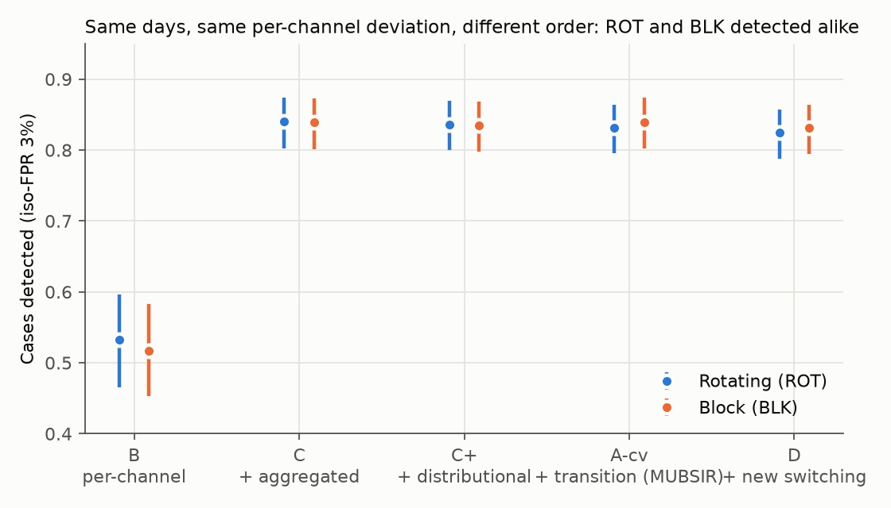
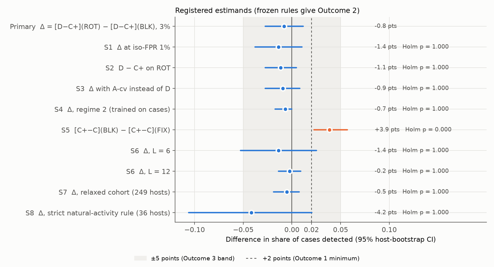

# Research Study: Controlled Channel Rotation and Independent Switching Signal in MUBSIR — Final report

**Date:** 2026-11-26 · **Data:** dev simulation only (859 users); the test set and test scores were never read ·
**Protocol:** `PREREGISTRATION.md`, SHA-256 `954fe7d4bfadbea19e4f5b6ad7df0a18b6c95cd17c24d15c28ca3d67644e24fe`,
frozen before any data generation or training and re-checked by every script · **Frozen MUBSIR:** not modified
(`hashes_comparison.json`: 350 files, 0 changed).

## Executive summary
- **Question:** with the deviation injected into each channel held fixed, does switching between channels (rotation) carry
  an independent signal that improves detection?
- **Primary result:** no. The new explicit switching features add no measurable value.
  - The registered difference is Δ = −0.8 points, 95% CI −2.8 to +1.2.
  - Every secondary analysis gives the same answer.
- **Outcome under the frozen rules: Outcome 2.** A post-hoc decomposition adds a caveat: the distributional features do
  **not** improve detection of multi-channel attacks (−0.5 points). Instead they **reduce** detection of single-channel
  attacks (−4.3 points).
- **What actually detects rotating attacks** is aggregated cross-channel deviation, not the switching pattern itself.
- **Recommendation:**
  - Add none of the switching features.
  - Do not modify the frozen model.
  - Scientifically supported claim: "MUBSIR detects rotating attacks as well as equivalent block attacks, through
    aggregated deviation rather than by recognising the switching pattern."

---

## 1. Question and design
**Question:** after holding the total and per-channel injected deviation fixed, does the *order* in which an attacker uses
channels (rotation) carry an independent signal that explicit switching features can exploit?

**Design (all pre-registered).** Each host is a real dev user. Its pre-injection 2011 history is used, and a new attack is
injected into it on the same days, with the same channels and the same deviation per channel-day, in different orders:

| Variant | Order on the L attack days | Use |
|---|---|---|
| ROT | rotating, π[j mod 3] (L − 1 switches) | primary |
| BLK | blocks, π[⌊3j/L⌋] (2 switches) | primary |
| FIX-c | one channel only | S5, descriptive |
| SIM | all three channels each day at δ/3 | descriptive (not matchable) |

**Injection and matching**
- Injection: `x' = max(x, P50) + δ·max(1, P95 − P50)`, δ = 1 E unit per channel-day, L ∈ {6, 12}.
- The primary cohort is the 145 hosts (73 benign, 72 attacker hosts) with integer baselines, for which ROT and BLK
  per-channel deviation is **identical**: max difference 2.2e-16 (`results/data_verification.csv`).
- Raw added counts differ slightly between ROT and BLK (for example Email 5.51 vs 5.48 for L = 6), because x' depends on
  the natural count of that day. This is reported in `results/data_summary.csv`.

**Arms** (LightGBM defaults, label y_10, Stage A folds, seeds 42 + repeat):

| Arm | Features | Count |
|---|---|---:|
| B | per-channel | 50 |
| C | + aggregated deviation | 65 |
| C+ | + distributional | 87 |
| A-cv | + existing transition features; the 100 MUBSIR features, refit | 100 |
| D | + 8 new sequence features and 2 personal-norm switching features | 110 |

**New switching features of arm D** (`rot_features.py`; PREREGISTRATION §5.1–§5.2). All are causal: the value at day t
uses days ≤ t only. They are computed from the daily per-channel deviation E_c(t) (= `E_*_today`).

Definitions used by the features:
- **Deviation day:** Σ_c E_c(t) > 0.
- **Dominant channel** dom(t) = argmax_c E_c(t), with ties broken Email < USB < HTTP.
- **Linked pair:** two consecutive deviation days with at most 2 quiet workdays between them.
- **Change:** a linked pair whose dominant channels differ.

| Feature | Windows | Definition | What it captures |
|---|---|---|---|
| `rot_changes_w` | 10, 20 | number of changes in the window | how often the attacker switches (a count, unlike the existing ratio `nr_gap_alt_2`) |
| `rot_revisits_w` | 10, 20 | deviation days whose dominant channel appeared earlier in the window but not on the previous deviation day | returns such as Email → USB → Email |
| `rot_trans_entropy_w` | 10, 20 | entropy of the 6 ordered change types (E→U, E→H, U→E, U→H, H→E, H→U) / ln 6; 0 if fewer than 2 changes | how varied the switching is |
| `rot_cycle_w` | 10, 20 | triples of consecutive deviation days with three different dominant channels and both pairs linked, / max(1, changes − 1) | full cycles through all three channels (E → U → H) |
| `sw_excess_rate_10` | 10 vs personal history | switching rate (changes / linked pairs) over [t−9, t] minus the employee's own rate over [t−70, t−11] | switching above the employee's habit |
| `sw_excess_count_10` | 10 vs personal history | `rot_changes_10` − personal rate × linked pairs in [t−9, t] | number of switches above the employee's habit |

Unit check on toy sequences:

| Sequence | Changes | Revisits | Cycle |
|---|---:|---:|---:|
| E U H E U H | 5 | 3 | 1.0 |
| E E U U H H | 2 | 0 | 0 |
| E × 6 | 0 | 0 | 0 |

The two personal-norm features were kept because the shortcut gate passed (AUC 0.572 < 0.60). D therefore has
100 + 8 + 2 = 110 features.

**Evaluation**
- Every case is scored only by fold models that never saw its host.
- Thresholds are cross-fitted from the whole-period peak scores of the 511 benign dev users in the other folds:
  iso-FPR 3% is primary, 1% is secondary.
- A case is detected if any day from its first attack day to its last attack day + 9 is above the threshold.
- CIs come from 2,000 host bootstraps, stratified by benign or attacker host.

## 2. Gates passed before any result
| Gate | Result |
|---|---|
| Gate 0: exact re-implementation of the 100 features | **PASS**: max abs diff 0.0 on all 995 users (injected) and on 595 benign users (pre-injection); NB10 mapping exact; negative control sensitive and causal |
| Data verification | **PASS**: 145 of 146 hosts (≥ 120 needed); totals exactly L·δ; nothing changed outside attack days |
| New-feature unit check | **PASS**: ROT changes 5 / revisits 3 / cycle 1; BLK 2 / 0 / 0; FIX 0 |
| Shortcut gate (§5.2) | user-level AUC of the habitual switching rate = 0.572 (< 0.60), so the personal-norm features are **kept** (D = 110) |
| Pipeline reproduction | A-cv reproduces the Stage A OOF scores **exactly** |
| Threshold calibration | realised held-out benign FPR: 3.0–3.5% at the 3% target, 1.0–1.3% at the 1% target, for every arm (`results/analysis_threshold_check.csv`) |
| Ceiling / floor | not reached: Det(C+, ROT) = 0.836, Det(C+, BLK) = 0.834 |

## 3. Primary result

Share of cases detected, iso-FPR 3%, 145 hosts, pooled over L, mean of 3 repeats:

| Arm | ROT | BLK | ROT − BLK |
|---|---:|---:|---:|
| B (per-channel) | 0.532 | 0.517 | +0.015 |
| C (+ aggregated) | **0.840** | **0.839** | +0.001 |
| C+ (+ distributional) | 0.836 | 0.834 | +0.002 |
| A-cv (= MUBSIR features) | 0.831 | 0.839 | −0.008 |
| D (+ new switching) | 0.824 | 0.831 | −0.007 |

**Primary estimand:** Δ = [D − C+](ROT) − [D − C+](BLK) = **−0.0080**, 95% CI **[−0.0276, +0.0115]**, p = 0.44.

| Outcome 1 condition | Required | Observed | Met |
|---|---|---|---|
| Δ ≥ 0.02 | ≥ +2 points | −0.8 points | ✗ |
| CI of Δ above 0 | lower bound > 0 | −2.8 points | ✗ |
| D − C+ on ROT > 0 with CI above 0 | > 0 | −1.1 points [−2.8, +0.5] | ✗ |
| No ceiling or floor | — | none | ✓ |

The new switching features do not improve detection of rotating attacks. Their point effect is slightly negative, and the CI
excludes any gain larger than about +1.2 points.

## 4. Secondary analyses (Holm across 9 tests)

| ID | Estimand | Estimate | 95% CI | Holm p |
|---|---|---:|---|---:|
| S1 | Δ at iso-FPR 1% | −1.4 pts | [−3.8, +1.0] | 1.00 |
| S2 | D − C+ on ROT | −1.1 pts | [−2.8, +0.5] | 1.00 |
| S3 | Δ with A-cv (existing MUBSIR transition features) instead of D | −0.9 pts | [−2.8, +0.8] | 1.00 |
| S4 | Δ, regime 2 (arms trained with counterfactual cases) | −0.7 pts | [−1.7, 0.0] | 1.00 |
| **S5** | **[C+ − C](BLK) − [C+ − C](FIX)** | **+3.9 pts** | **[+2.3, +5.7]** | **< 0.005** |
| S6 | Δ, L = 6 | −1.4 pts | [−5.3, +2.5] | 1.00 |
| S6 | Δ, L = 12 | −0.2 pts | [−1.4, +0.9] | 1.00 |
| S7 | Δ, relaxed cohort (249 hosts, approximate matching) | −0.5 pts | [−1.9, +0.7] | 1.00 |
| S8 | Δ, original natural-activity rule (36 hosts) | −4.2 pts | [−10.6, +2.0] | 1.00 |

- Every switching interaction (S1–S4, S6–S8) is near zero, with point estimates on the negative side.
- S3 shows that MUBSIR's **existing** transition features (`nr_alt`, `nr_gap_alt_2`, `nr_handoff`,
  `dominant_channel_switches`) carry no ordering-specific signal either.
- **Notes on informativeness:**
  - S4 is close to ceiling: regime-2 detection is 0.99–1.00 for both variants.
  - L = 12 is close to ceiling: 0.98–0.99 for every arm.
  - S8 is underpowered (48 cases), as anticipated in the protocol.
  - The pooled primary is therefore driven mostly by L = 6.

## 5. Outcome by the frozen rules
**Outcome 2: "distributed deviation matters, explicit switching does not."** The primary test fails, and S5 is positive
after Holm correction.

Outcome 3 ("neither adds value") does not apply, because S5 is significant and its CI reaches +5.7 points, above the ±5 band.
This mapping follows the frozen rules exactly; no rule was changed after results were seen.

### 5.1 How S5 arises (post-hoc, descriptive, no test; `posthoc_descriptive.py`)
S5 is a difference of differences. Decomposed per variant (iso-FPR 3%, 95% host-bootstrap CI):

| Variant | C | C+ | C+ − C | A-cv − C |
|---|---:|---:|---|---|
| ROT | 0.840 | 0.836 | −0.5 [−2.2, +1.3] | −0.9 [−2.9, +1.0] |
| BLK | 0.839 | 0.834 | −0.5 [−1.8, +1.0] | 0.0 [−1.7, +1.7] |
| FIX (pooled) | 0.759 | 0.716 | **−4.3 [−5.5, −3.2]** | **−3.1 [−4.4, −1.7]** |
| FIX-Email | 0.801 | 0.783 | −1.8 [−3.1, −0.6] | −0.9 [−2.6, +0.7] |
| FIX-USB | 0.721 | 0.667 | −5.4 [−7.6, −3.3] | −4.0 [−6.6, −1.6] |
| FIX-HTTP | 0.755 | 0.698 | −5.7 [−7.5, −3.9] | −4.4 [−6.3, −2.5] |

S5 is positive **not because distributional features help multi-channel attacks**: their effect on BLK is −0.5 points.
It is positive because they **reduce** detection of single-channel attacks of the same total deviation, by 4.3 points.

So the frozen label "distributed deviation matters" should be read narrowly. The distributional features change *which*
attacks the model favours, multi-channel over single-channel. They do not add detection over aggregated deviation (arm C) for
any variant.

## 6. Descriptive results
- **Feature-family ladder** (`results/analysis_arm_ladder.csv`):
  - Almost the whole gain comes from the aggregated deviation features: B → C is +31 points on ROT and +32 on BLK.
  - Every later family adds ≈ 0 or less, and equally on ROT and BLK.
  - At 1%, two of ten unadjusted ladder interactions have CIs excluding zero, in opposite directions: C+ → A-cv −4.1, A-cv → D +2.8. This is consistent with chance across ten unregistered comparisons, and no conclusion is drawn.
- **Detection at iso-FPR 1%:** C 0.753 / 0.737 (ROT / BLK), C+ 0.723 / 0.717, A-cv 0.701 / 0.737, D 0.698 / 0.706.
- **Latency** (median workdays from the first attack day, detected cases, 3%):
  - ROT is detected one day earlier than BLK: 3 vs 4 at L = 6, and 4 vs 5 at L = 12.
  - This holds for **every** arm, including C, which has no transition features. So the earlier detection follows from
    ordering itself, not from switching features. A plausible reason, not tested here, is that ROT reaches every channel,
    including the most detectable one, by day 3.
- **Unique detections** (ROT, 3%, in ≥ 2 of 3 repeats): D detects 0 cases that C+ misses; C+ detects 5 that D misses.
  At 1%: 3 vs 8.
- **SIM** (descriptive; carries more deviation than the matched variants): 0.90–0.92 at 3% for C, C+ and D.
- **Frozen MUBSIR (A-frozen)** at its operating point risk > 85. This is descriptive only, and in-sample for the hosts' own
  benign days.

  | Variant | L = 6 | L = 12 |
  |---|---:|---:|
  | ROT | 64.1% | 96.6% |
  | BLK | 65.5% | 97.2% |
  | FIX-USB | 37.2% | 95.9% |
  | FIX-HTTP | 37.2% | 94.5% |
  | SIM | 84.1% | 99.3% |

  The frozen model treats ROT and BLK alike.
- **By host type:** detection is higher on attacker hosts than on benign hosts for every arm (for example C+ ROT 0.877 vs
  0.795), and the ROT ≈ BLK pattern holds in both (`results/analysis_detection_table.csv`).

## 7. Conclusions
1. **No independent switching signal was found.** With per-channel deviation held fixed, rotating and block attacks are
   detected equally by every arm. Neither the new explicit switching features nor MUBSIR's existing transition features add
   ordering-specific detection. The primary CI excludes gains above about 1.2 points; the relaxed cohort excludes gains
   above about 0.7 points.
2. **What detects rotating attacks is aggregated cross-channel deviation** (arm C). Rotation does not help an attacker
   evade MUBSIR, but MUBSIR does not catch rotation *because* it rotates.
3. **Supported claim:** "MUBSIR detects rotating exfiltration as well as block-structured exfiltration with the same
   per-channel deviation, through aggregated cross-channel deviation." **Not supported:** "MUBSIR detects
   channel-switching behaviour" or "MUBSIR's switching features contribute to detection."

## 8. Recommendation
- **Do not add the D features** (new sequence features or personal-norm switching) to MUBSIR. Outcome 1 was not reached,
  so the protocol allows no experimental version.
- **Do not change the frozen model** on the basis of this study. The protocol forbids it, and the evidence does not call
  for it.
- **For the thesis or report:** describe the transition features as "included but not shown to add independent value".
  Cite this study together with `study_rotation/` (the advantage over siloed monitors comes from modelling all channels
  together, not from `nr_*` features).
- **Possible follow-up (not proposed as a change):**
  - In these controlled cases, the 65-feature arm C detected single-channel low-and-slow attacks 3.1 points better than the
    full 100-feature set, at a slightly lower realised FPR (3.00% vs 3.46%), and was equal on multi-channel ones.
  - This is a post-hoc observation on synthetic injections. A simpler feature set would need its own pre-registered study
    on the original dev simulation before any decision.

## 9. Limitations
- **Synthetic injections.** Fixed δ = 1 E unit per channel-day, on real benign histories, using only dev users.
- **Changed assumption (condition 1).** Injection on days where the host did not naturally use the channel. The original
  rule (S8) gives the same direction but is underpowered.
- **Exact matching** is possible only for hosts with integer baselines (145 of 253). The approximate cohort (S7) agrees.
- **Ceiling effects.** L = 12 and regime 2 are near ceiling. The informative contrast is L = 6, where the CI is wider
  (±4 points).
- **Comparison range.** Only one δ, two lengths and LightGBM defaults were compared. Larger or more numerous switches, or
  other model families, were not studied.
- **Unequal realised FPR.** Iso-FPR is set on benign dev users' whole-period peaks, so the realised held-out FPR differs
  slightly between arms (3.0–3.5%).

## 10. Integrity and reproducibility
- **Frozen artefacts.** All 350 pre-existing `Model/` files have SHA-256 identical before and after the study
  (`hashes_before.json`, `hashes_after.json`, `hashes_comparison.json`). The external read-only inputs are hashed in
  `INPUTS.md`.
- **Test data.** The test set and `work/test/test_scores.parquet` were never read.
- **Where outputs live.** Every output is inside `study_controlled_rotation/`. No `__pycache__` or other file was created
  in frozen folders.
- **Reproducibility.**
  - Seeds: data generation uses rng 42 (H146), 43 (R253) and 44 (S8); training uses 42 + repeat; the bootstrap uses
    rng 2026.
  - Commands are in `EXPERIMENT_LOG.md`; `run_all.ps1` reproduces the study in order.
  - Running it again overwrites the integrity baseline with the then-current state.
- **Analysis choices not specified by the protocol** were fixed and logged before the analysis ran (`EXPERIMENT_LOG.md`).
  The post-hoc decomposition (§5.1) and the ladder (§6) are labelled descriptive and do not affect the outcome.
