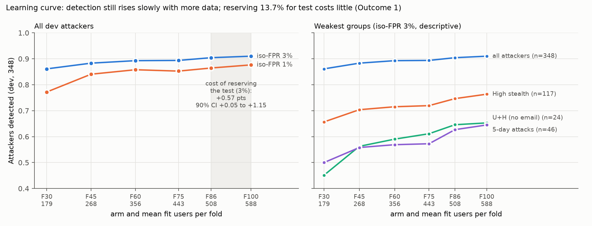

# Report: Learning curve and the cost of reserving the test set

**Pre-registration:** `PREREGISTRATION.md`, frozen 2026-11-26 (sha `5be9e028…`).
**Data:** dev users only (859: 348 attackers, 511 benign). The test set was not used.
**Outcome under the frozen rules: Outcome 1, reserving the test costs little.**

## 1. Question

MUBSIR v2 keeps 136 of 995 users (13.7%) as a locked test set. Training on 13.7% fewer users could lower detection. How
much?

## 2. Method (summary)

- The Stage A model was retrained on 30%, 45%, 60%, 75%, 86% and 100% of each fold's training (`fit`) users.
- Users were sampled by schedule group within each stratum. The subsamples are nested, with 2 subsample seeds per
  fraction.
- Early-stopping and validation users were the same for every arm.
- **F86 versus F100** has the same ratio as "dev only" versus "dev + test" (859 / 995).
- Detection = share of the 348 dev attackers caught at iso-FPR 3%, the same definition as the earlier studies.
- 95% and 90% CIs come from a 2,000-resample user bootstrap.

**Gates, all PASS:**
- **G1:** F100 reproduces the Stage A OOF scores exactly (difference 0).
- **G2:** subsample sizes are within the registered tolerance, the subsamples are nested, and all strata are kept.
- **G3:** frozen files are unchanged.

## 3. Results

### Learning curve (dev, out-of-fold)

| Arm | Fit users per fold | Detected @3% | Detected @1% | Row PR-AUC | User AUC | Benign FPR @3% (realised) |
|---|---:|---:|---:|---:|---:|---:|
| F30 | 179 | 86.1% | 77.2% | 0.921 | 0.979 | 3.4% |
| F45 | 268 | 88.3% | 84.1% | 0.930 | 0.982 | 3.2% |
| F60 | 356 | 89.3% | 85.8% | 0.934 | 0.984 | 3.5% |
| F75 | 443 | 89.4% | 85.2% | 0.938 | 0.985 | 3.2% |
| **F86** | **508** | **90.4%** | **86.4%** | **0.940** | **0.987** | 3.3% |
| **F100** | **588** | **91.0%** | **87.6%** | **0.943** | **0.987** | 3.5% |

### Registered estimands

| ID | Estimand | Estimate | 95% CI | 90% CI | Holm p |
|---|---|---:|---|---|---:|
| **Primary** | Det(F100) − Det(F86), iso-FPR 3% | **+0.57 pts** | −0.05 to +1.25 | **+0.05 to +1.15** | (p = 0.093) |
| S1 | the same at iso-FPR 1% | +1.20 pts | +0.53 to +1.96 | +0.62 to +1.82 | < 0.001 |
| S2 | row PR-AUC(F100) − PR-AUC(F86) | +0.0031 | +0.0023 to +0.0039 | | < 0.001 |
| S3 | Det(F100) − Det(F60), iso-FPR 3% | +1.72 pts | +0.77 to +2.78 | | < 0.001 |

**Outcome 1 applies:** the 90% CI of the primary estimand (+0.05 to +1.15 points) lies inside the registered
equivalence band of ±2 points.

## 4. Interpretation

1. **Reserving 13.7% of the users for the test cost about half a detection point.**
   - The cost is +0.57 points at iso-FPR 3% and +1.2 points at 1%.
   - Both are below the 2-point threshold that the study registered as practically meaningful.
   - The 1% difference is statistically significant (Holm). It is therefore reported, but by the frozen rules it does
     not change the outcome.
2. **More data still helps, but slowly.**
   - From 60% to 100% of the data, detection rises 1.7 points (S3, significant).
   - The curve flattens: about +2.2 points per 90 users at the start, and about +0.6 points for the last 80.
3. **The weakest groups benefit most from more data (descriptive, small groups):**

   | Group | F86 | F100 |
   |---|---:|---:|
   | 5-day attacks (n = 46) | 62.7% | 64.5% |
   | High stealth (n = 117) | 74.6% | 76.4% |
   | U+H, no email (n = 24) | 64.6% | 65.3% |

   These groups are small, so their differences are noisy. They are not tests.
4. **Extrapolation (model-based, not a measurement).**
   - A power-law curve was fitted to the six points: Det(n) = 0.965 − 1.35·n^(−0.497).
   - At the final model's scale, it predicts that adding the 136 test users would raise detection from 91.8% to
     92.1%, a gain of about **+0.3 points**.

## 5. What this means for the split

The 86/14 split is supported by evidence, not only by convention:
- The test set is large enough for a usable estimate. With 52 attackers, an exact (Clopper–Pearson) 95% CI for recall
  is about 16 points wide.
- The test set is representative. A chi-square test of dev versus test gives p ≥ 0.68 for stealth, duration,
  switching, channel configuration, benign channel set and the attacker share. These are composition checks only and
  use no scores.
- Keeping it out of training costs about 0.6 detection points (90% CI 0.05–1.15).

## 6. Limitations

- **Scale.** The curve is measured at cross-validation scale (up to 588 fit users), while the final model used 859.
  The cost at full scale is expected to be smaller because the curve is concave. This is an assumption, and it was not
  tested.
- **Fixed early-stopping set.** The `es` set was not subsampled.
- **Simulated attacks.** All attacks are simulated, so the curve describes this dataset.
- **No change to the model.** Nothing about the frozen model or split was changed.

## 7. Integrity

- `hashes_comparison.json` compares every project file before and after the study.
- Excluded from the comparison, besides this folder: `.venv`, `__pycache__`, `mubsir_system/` and `deliverables/`.
- External inputs, with their SHA-256, are listed in `INPUTS.md`.
