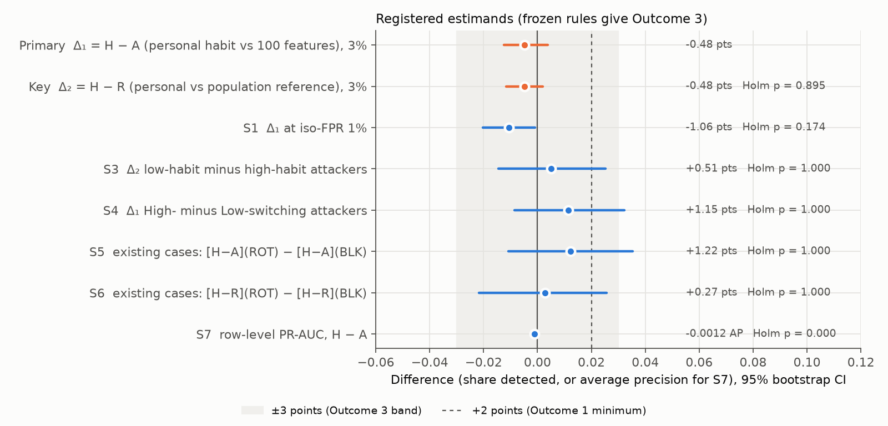
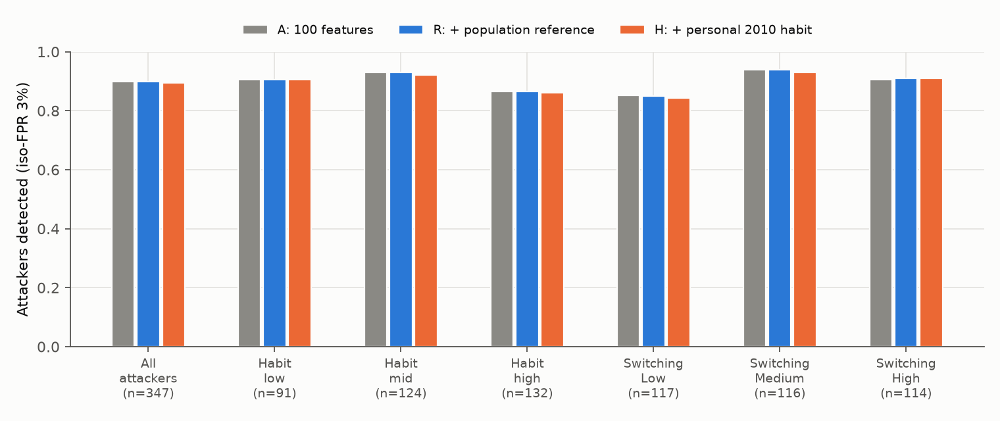

# Research Study: Habit-Relative Channel Switching (2010 Switching Baseline) in MUBSIR — Final report

**Date:** 2026-11-26
**Data:** existing Dev simulation and existing controlled cases only. No attack data was generated, simulated, injected
or modified. The test set and test scores were not used.
**Protocol:** `PREREGISTRATION.md`, SHA-256 `55f15d44a978c58db6a45b73c9f077de042ede430cff31dac78abaafe4da6bef`,
frozen before any 2011 switching feature, training or estimand, and re-checked by every later script.
**Frozen artefacts:** unchanged. `hashes_comparison.json` covers 448 files, including the closed studies, with 0 changed.

## Executive summary
- **Question:** does measuring channel switching relative to each employee's own 2010 switching rate add detection
  information beyond the 100 MUBSIR features?
- **Answer: no meaningful added value (Outcome 3 under the frozen rules).**
  - Primary: Det(H) − Det(A) = **−0.5 points**, 95% CI −1.3 to +0.4.
  - Personal vs population reference: Det(H) − Det(R) = **−0.5 points**, 95% CI −1.2 to +0.2.
  - Both CIs exclude gains larger than about half a point.
- **No subgroup shows an effect.** The habit-relative features help neither employees who rarely switch nor
  high-switching attackers, and they make no difference between rotating and block attacks in the existing matched cases.
- **One significant secondary result points slightly the wrong way:** row-level PR-AUC is 0.0012 lower with the habit
  features. This is negligible in practice.
- **Recommendation:**
  - Do not add habit-relative switching features to MUBSIR.
  - Do not change the frozen model.
  - Together with `study_controlled_rotation/`, no form of switching information tested (raw, transition-based, rolling
    personal norm, fixed 2010 habit) adds detection value beyond MUBSIR's aggregated deviation features in this
    simulation.

---

## 1. Question and design
The closed study `study_controlled_rotation/` compared switching with a rolling 2011 window, bundled it with other
features, and never split employees by habit. This study fixes all three:
1. **Habit from the fixed 2010 baseline period.** Each employee's 2010 switching rate r₀ = channel changes / linked
   deviation-day pairs. It uses the same period and the same deviation E as the volume baselines (P50/P95); that
   definition was reproduced exactly (AUDIT §1).
2. **A rate, not a count.** A count-based habit identified future attackers with AUC 0.74, a shortcut (AUDIT §4). The
   rate identified them with AUC 0.58.
3. **Three arms that isolate the personal reference:**

| Arm | Features | Count |
|---|---|---:|
| **A** | the 100 MUBSIR features (refit) | 100 |
| **R** | A + switching rate / excess switches over 10 and 20 days, relative to the **population** median rate m₀ = 0.444 | 104 |
| **H** | A + the same four quantities relative to the employee's **own 2010 rate r₀** | 104 |

R and H carry identical switching information and differ only in the reference. So H − A is the total added value, and
H − R is the value of the personal baseline itself.

**Populations**
- **P1 (primary):** the 714 dev users with a measurable 2010 habit (≥ 20 linked pairs): 347 attackers and 367 benign.
  Every arm is trained and evaluated on exactly these users, so that "no habit" cannot act as a benign label (§7).
- **P2 (secondary):** the existing matched H146 cases (ROT/BLK/FIX/SIM) of the 123 habit-eligible hosts, read-only.

**Evaluation**
- Training: the existing 5×3 grouped folds restricted to P1, LightGBM defaults, label y_10, seeds 42 + repeat.
- Thresholds: cross-fitted iso-FPR (3% primary, 1% secondary) from the benign P1 users in the other folds.
- Detection: an attacker is detected if any y_10 = 1 day scores above the threshold.
- Uncertainty: 2,000 stratified user or host bootstrap resamples; Holm across S1–S7.

## 2. Gates (all passed before any estimand)
| Gate | Result |
|---|---|
| G1: feature correctness | toy sequences exact (ROT: 5 switches, habit deviation 0.6; BLK: 2, 0); causal; r₀ reproduced exactly for all 714 users |
| G2: shortcut | per-user pre-attack means separate attackers from benign with AUC R 0.51–0.53 and H 0.55–0.57, all below 0.60. H carries slightly more identity information than R, but within the limit |
| G3: folds | every validation fold has ≥ 67 benign users and ≥ 68 attackers; no group overlap |
| G4: pipeline | pipeline code, folds, rules, dataset and labels identical to the pre-study hashes |
| Threshold calibration | realised held-out benign FPR at the 3% target: A 3.0%, R 3.8%, H 3.3%; at the 1% target: 1.3%, 1.0%, 1.3% |

## 3. Primary and key secondary results

| | A | R | H |
|---|---:|---:|---:|
| Attackers detected, iso-FPR 3% | 0.899 | 0.899 | 0.894 |
| Attackers detected, iso-FPR 1% | 0.864 | 0.853 | 0.853 |
| Row-level PR-AUC (OOF) | 0.9442 | — | 0.9430 |

| Estimand | Estimate | 95% CI | p (Holm) |
|---|---:|---|---:|
| **Primary Δ₁ = H − A (3%)** | **−0.48 pts** | [−1.25, +0.38] | 0.27 (unadjusted) |
| **Key Δ₂ = H − R (3%)** | **−0.48 pts** | [−1.15, +0.19] | 0.90 |
| R − A (descriptive) | 0.00 pts | [−0.58, +0.58] | — |

**Outcome rules (§11), applied in order:**
1. No gate failed.
2. **Outcome 1 not met:** Δ₁ < +2 points and its CI includes 0.
3. **Outcome 2 not met:** the Δ₁ CI includes 0.
4. **Outcome 3 met:** the CIs of Δ₁ and Δ₂ both lie inside (−3, +3) points.

**Result: Outcome 3, no meaningful added value.** The data exclude gains above about +0.4 points (Δ₁) and +0.2 points
(Δ₂).

## 4. Secondary analyses (Holm across 7 tests)
| ID | Estimand | Estimate | 95% CI | Holm p |
|---|---|---:|---|---:|
| S1 | Δ₁ at iso-FPR 1% | −1.06 pts | [−2.02, −0.10] | 0.17 |
| S2 | Δ₂ at iso-FPR 3% | −0.48 pts | [−1.15, +0.19] | 0.90 |
| S3 | Δ₂ low-habit minus high-habit attackers | +0.51 pts | [−1.45, +2.52] | 1.00 |
| S4 | Δ₁ High- minus Low-switching attackers | +1.15 pts | [−0.86, +3.22] | 1.00 |
| S5 | existing cases: [H − A](ROT) − [H − A](BLK) | +1.22 pts | [−1.08, +3.52] | 1.00 |
| S6 | existing cases: [H − R](ROT) − [H − R](BLK) | +0.27 pts | [−2.17, +2.57] | 1.00 |
| S7 | row-level PR-AUC, H − A | −0.0012 | [−0.0019, −0.0006] | < 0.005 |

- **S3 tests the owner's hypothesis directly:** if comparison with the personal habit matters, it should help more for
  employees who rarely switch. It does not: the difference is +0.5 points with CI −1.5 to +2.5, so no large effect.
- **S4 and S5 point slightly in the expected direction** (more help for high-switching and rotating attacks), but both are
  small and not significant.
- **S7 is the only significant result, and it goes the other way.** The habit features slightly lower row-level ranking
  quality. The size, 0.0012 in average precision, has no practical importance.
- **S1** is nominally negative at the 1% operating point but not significant after Holm correction.

## 5. Descriptive results

Attackers detected, iso-FPR 3% (`results/analysis_p1_detection_table.csv`):

| Group | n | A | R | H | H − A [95% CI] |
|---|---:|---:|---:|---:|---|
| All | 347 | 0.899 | 0.899 | 0.894 | −0.005 [−0.012, +0.004] |
| Habit low (r₀ ≤ 0.387) | 91 | 0.905 | 0.905 | 0.905 | 0.000 [−0.022, +0.025] |
| Habit mid | 124 | 0.930 | 0.930 | 0.922 | −0.008 [−0.021, +0.003] |
| Habit high (r₀ > 0.5) | 132 | 0.866 | 0.866 | 0.861 | −0.005 [−0.015, +0.005] |
| Switching Low | 117 | 0.852 | 0.849 | 0.843 | −0.009 [−0.021, +0.003] |
| Switching Medium | 116 | 0.940 | 0.940 | 0.931 | −0.009 [−0.022, +0.003] |
| Switching High | 114 | 0.906 | 0.909 | 0.909 | +0.003 [−0.013, +0.020] |
| 2 channels | 228 | 0.877 | 0.876 | 0.870 | −0.007 [−0.017, +0.002] |
| 3 channels | 119 | 0.941 | 0.944 | 0.941 | 0.000 [−0.015, +0.016] |
| Stealth High | 117 | 0.724 | 0.726 | 0.715 | −0.009 [−0.031, +0.015] |

- **Existing matched cases (P2, 3%):**

  | Variant | A | R | H |
  |---|---:|---:|---:|
  | ROT | 0.798 | 0.799 | 0.782 |
  | BLK | 0.828 | 0.820 | 0.799 |

  H is not better on either, and FIX and SIM show the same pattern (`results/analysis_p2_detection_table.csv`). Only
  17 eligible hosts fall in the low-habit tertile, so the P2 tertile split is descriptive.
- **Unique detections** (in ≥ 2 of 3 repeats):
  - at 3%: H detects 1 attacker that A misses, and A detects 0 that H misses;
  - at 1%: 0 and 2.
- **Latency:** the median is 3 workdays for every arm at 3%, and 4 at 1%.
- **The weakest group is unchanged:** high-stealth attackers remain the main gap (0.72 at 3%), and habit-relative
  switching does not reduce it.

## 6. Conclusions
1. **Measuring switching relative to the employee's historical rate adds no useful information** beyond the existing
   features in this Dev simulation. The effect is bounded: any true gain at 3% is below about 0.4 points.
2. **The personal reference does no better than a population reference** (H − R ≈ 0). So the closed study's null result
   was not caused by the lack of a personal baseline.
3. **No group benefits:** neither employees who rarely switch, nor high-switching attackers, nor rotating attacks.
4. **Combined with `study_controlled_rotation/`:** in this simulation, rotating exfiltration is detected through
   aggregated cross-channel deviation. Switching information, in any of the forms tested, is redundant with it.

## 7. Recommendation
- **Do not add habit-relative switching features to MUBSIR. Do not change the frozen model.** Outcome 1 was not reached,
  and the protocol forbids changes in any case.
- **Thesis wording:** "Switching measured relative to each employee's 2010 switching rate was evaluated in a
  pre-registered study and added no measurable detection value (Δ = −0.5 points, 95% CI −1.3 to +0.4)."
- **Effort elsewhere:** remaining effort is better spent on the known weak spots (high-stealth and short attacks) than on
  switching features.

## 8. Limitations
- **Population restriction.** The 714 habit-eligible users are not all Dev users. 144 of the 511 benign users had too
  little 2010 activity to measure a habit, so results apply to employees with measurable multi-channel activity. This
  restriction was necessary to avoid a missing-habit shortcut.
- **Habit stability is moderate.** 2010 vs 2011 pre-attack rate has Spearman ρ = 0.37 (AUDIT §3). A noisier habit weakens
  any habit-relative signal; the volume baselines share this limitation.
- **Simulated attacks.** The simulation injected attacks only into channels the employee naturally used, and its switching
  levels are design parameters. Real attackers whose switching departs more sharply from a stable personal habit were not
  available to test.
- **Feature family.** Only rate-based features (4 per arm, windows 10 and 20) were tested. Other formulations, such as
  longer windows or per-channel-pair habits, were not.
- **Power.** S3–S6 resolve only effects of roughly ≥ 3–5 points. Their nulls mean "no large effect".

## 9. Integrity and reproducibility
- **Generated data.** No attack data was generated, simulated, injected or modified. P2 features were computed by reading
  the closed study's cases, which are unchanged (hash verified).
- **Frozen artefacts.** All 448 pre-existing `Model/` files, including the closed studies, have identical SHA-256 before
  and after the study (`hashes_comparison.json`). External inputs are hashed in `INPUTS.md`.
- **Test data.**
  - The test scores and every test decision were never read.
  - `model_dataset_995.parquet` is opened whole by the frozen loader, and test users' rows are dropped immediately,
    before any computation, as in every earlier study.
- **Reproducibility.**
  - Seeds: training uses 42 + repeat; the bootstrap uses `default_rng(2026)`.
  - Commands are in `EXPERIMENT_LOG.md`, and `run_all.ps1` reproduces the study in order.
  - Implementation choices not fixed by the protocol were logged before the analysis ran.
- **Owner decisions** are recorded in `EXPERIMENT_LOG.md`: no new attack generation; habit as a rate; recommended choices
  frozen.
