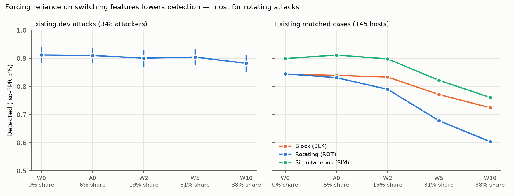
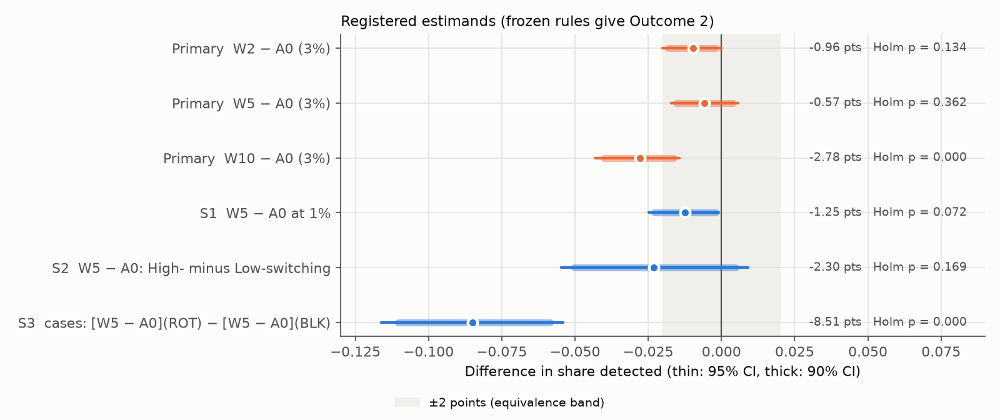

# Research Study: Up-weighting Switching Features in MUBSIR Training — Final report

**Date:** 2026-11-26.

**Data:** the existing Dev simulation and the existing matched cases only. No attack data was generated, simulated,
injected or modified. The test set was not used.

**Protocol:** `PREREGISTRATION.md`, SHA-256 `6809b403cd0a15557b61f0f2c9b38627b30f1a971b7ba5bdaba968a10eea5dd6`. It was
frozen before any training on project data and is re-checked by every script.

**Frozen artefacts:** unchanged. `hashes_comparison.json` covers 506 files, closed studies included; 0 changed.

## Executive summary
- **Question:** if MUBSIR is forced during training to rely more on its 13 channel-switching features, does detection
  change? The owner's hypothesis was "no change, because the information is redundant with volume".
- **The weighting worked as intended.** The switching features' share of the model (mean |SHAP|) rose from 5.8%
  (original) to 19%, 31% and 38% for weights 2, 5 and 10. At weight 10, 87% of all tree splits use them.
- **Outcome under the frozen rules: Outcome 2, up-weighting harms detection.**
  - On the 348 existing dev attackers, weights 2 and 5 stay within the ±2-point band: −1.0 and −0.6 points.
  - Weight 10 lowers detection by **2.8 points** (95% CI −4.3 to −1.4).
  - Row-level ranking quality falls at every weight.
- **The harm concentrates on rotating attacks**, the very pattern the switching features are meant to catch.
  - In the existing matched cases, detection of rotating attacks falls from 0.83 to 0.68 (weight 5) and 0.60 (weight 10).
  - The weight-5 loss on rotating attacks is 8.5 points larger than on block attacks of the same deviation (Holm p < 0.005).
  - The switching features alone detect only 16% of rotating cases, versus 37% of block cases.
- **The owner's hypothesis is partly supported.**
  - Removing the switching features (W0) or up-weighting them moderately leaves dev detection practically unchanged,
    which is the redundancy predicted.
  - Strong reliance on them is harmful, and the frozen rule requires all three weights to be equivalent.
- **Recommendation:** keep the frozen MUBSIR configuration. Do not up-weight switching features.

---

## 1. Design
- **Switching features (13, existing):** `nr_alt_{5,10,20}wd`, `nr_gap_alt_2_{5,10,20}wd`, `nr_handoff_{5,10,20}wd` and
  `dominant_channel_switches_{5,10,20,30}wd`.
- **Weighting mechanism:** LightGBM `feature_contri` multiplies a feature's split gain by its factor, so the trees prefer
  that feature whenever it is near the best split.
  - The factor is passed as a parameter to the frozen model constructor (`models._lgbm`). Nothing else changes: same
    defaults, label `y_10`, Stage A folds, early stopping and seeds.
  - A mechanism check on synthetic data was done before pre-registration (`EXPERIMENT_LOG.md`).

| Arm | Factor on switching features | Role |
|---|---:|---|
| A0 | 1 | the frozen MUBSIR configuration |
| W2 / W5 / W10 | 2 / 5 / 10 | up-weighted |
| W0 | 0 (never split on) | descriptive: switching removed |
| SW-only | the 13 switching features alone | descriptive: switching signal on its own |

**Populations**
- **P1 (primary):** all 859 dev users (348 attackers, 511 benign).
- **P2 (secondary):** the existing matched cases of `study_controlled_rotation/`: 145 hosts; ROT, BLK, FIX ×3, SIM;
  L ∈ {6, 12}. Read-only.

**Evaluation**
- **Thresholds:** cross-fitted iso-FPR (3% primary, 1% secondary) from the benign dev users of the other folds.
- **Detection:** an attacker is detected if any y_10 = 1 day scores above the threshold.
- **Uncertainty:** 2,000 stratified bootstrap resamples (users for P1, hosts for P2).

**Decision rules (in order)**
1. **Outcome 4 (gate):** G1, G2 or G3 fails.
2. **Outcome 2 (harm):** for at least one weight, the 95% CI is entirely below 0 and the drop is at least 2 points.
3. **Outcome 1 (same detection):** for all three weights, the 90% CI lies within ±2 points.
4. **Outcome 3 (help):** for at least one weight, a gain of at least 2 points, significant after Holm correction.
5. **Outcome 4:** none of the above.

## 2. Gates (all passed)
| Gate | Result |
|---|---|
| G3 integrity | pipeline, folds, rules, dataset, labels and the closed study's cases are identical to the pre-study hashes |
| G1 reproduction | A0 out-of-fold scores equal the Stage A OOF exactly (max difference 0), so the weight is the only difference between arms |
| G2 manipulation check | switching share of mean \|SHAP\|: W0 0%, **A0 5.8%**, W2 19.4%, W5 31.5%, **W10 38.0%**. Monotone, and W10 is 6.6 × A0 (≥ 2 × required). Share of tree splits on switching features: 8% → 34% → 74% → 87% |
| Threshold calibration | realised held-out benign FPR 3.0–3.7% at the 3% target, and 1.0–1.3% at the 1% target, for every arm |

## 3. Primary result: existing dev attacks (P1)

| Arm | Switching share | Detected, 3% | Detected, 1% | Row PR-AUC |
|---|---:|---:|---:|---:|
| W0 (switching removed) | 0% | 0.912 | 0.877 | 0.9443 |
| **A0 (frozen configuration)** | 5.8% | **0.910** | **0.876** | **0.9434** |
| W2 | 19.4% | 0.900 | 0.866 | 0.9396 |
| W5 | 31.5% | 0.904 | 0.864 | 0.9331 |
| W10 | 38.0% | 0.882 | 0.846 | 0.9253 |
| SW-only (switching alone) | 100% | 0.503 | 0.317 | 0.6964 |

| Estimand (iso-FPR 3%) | Estimate | 95% CI | 90% CI | Holm p (over the 3 weights) |
|---|---:|---|---|---:|
| Δ W2 − A0 | −0.96 pts | [−2.01, 0.00] | [−1.82, −0.19] | 0.13 |
| Δ W5 − A0 | −0.57 pts | [−1.72, +0.57] | [−1.53, +0.38] | 0.36 |
| **Δ W10 − A0** | **−2.78 pts** | **[−4.31, −1.44]** | [−4.02, −1.63] | **< 0.005** |

**Applying the frozen rules:**
1. All gates pass.
2. **Harm applies:** W10's 95% CI lies entirely below 0 and the drop is ≥ 2 points.
3. Equivalence would have required all three weights within ±2 points; W10 is outside, so it does not apply.

**Result: Outcome 2, up-weighting harms detection.** W2 and W5 taken alone lie inside the ±2-point band; their 90% CIs
are within it.

## 4. Secondary analyses (Holm across S1–S4)

| ID | Estimand | Estimate | 95% CI | Holm p |
|---|---|---:|---|---:|
| S1 | W5 − A0 at iso-FPR 1% | −1.25 pts | [−2.49, −0.10] | 0.07 |
| S2 | W5 − A0, High-switching minus Low-switching attackers | −2.30 pts | [−5.48, +0.92] | 0.17 |
| **S3** | **existing cases: [W5 − A0](ROT) − [W5 − A0](BLK)** | **−8.51 pts** | **[−11.61, −5.40]** | **< 0.005** |
| **S4** | **row PR-AUC W5 − A0** | **−0.0103** | **[−0.0125, −0.0083]** | **< 0.005** |

### Existing matched cases (P2), detected at 3%
| Variant | W0 | A0 | W2 | W5 | W10 | SW-only |
|---|---:|---:|---:|---:|---:|---:|
| **ROT (rotating)** | 0.845 | 0.831 | 0.790 | **0.678** | **0.603** | **0.155** |
| BLK (blocks) | 0.844 | 0.839 | 0.833 | 0.771 | 0.724 | 0.372 |
| SIM (simultaneous) | 0.899 | 0.911 | 0.898 | 0.822 | 0.761 | 0.131 |
| FIX-Email | 0.794 | 0.792 | 0.784 | 0.733 | 0.709 | 0.316 |
| FIX-USB | 0.682 | 0.680 | 0.666 | 0.614 | 0.594 | 0.298 |
| FIX-HTTP | 0.715 | 0.711 | 0.690 | 0.636 | 0.620 | 0.299 |

In the matched cases every variant loses detection as the weight rises, and **rotating attacks lose the most**: −22.8
points at W10. Used alone, the switching features flag rotating cases less often than block or single-channel cases. As
learned from this simulation, they do not mark rotation as suspicious.

## 5. Descriptive results
- **By attacker group** (detected at 3%, A0 → W10):
  - High switching: 0.919 → 0.867.
  - Low switching: 0.863 → 0.858.
  - High stealth: 0.764 → 0.695.
  - Three channels: 0.958 → 0.913.

  The losses are largest where one might expect switching features to help (high switching, three channels).
  `results/analysis_p1_detection_table.csv` has the full table.
- **Unique detections** (in ≥ 2 of 3 repeats, at 3%):
  - W10 detects 1 attacker that A0 misses, and A0 detects 9 that W10 misses.
  - W0 and A0 detect exactly the same attackers.
- **Benign false alarms vs habit:** among habit-eligible benign users alarmed at 3%, the share who are habitual switchers
  (high 2010 switching tertile) is 30% for A0, 37% for W10 and 35% for SW-only. Their base rate is 28%. Strong reliance
  on switching shifts false alarms somewhat towards employees who naturally switch a lot (descriptive).
- **Removing switching (W0) costs nothing:** 0.912 vs 0.910 at 3%, and the same detected attackers. This is consistent
  with the redundancy found in the earlier studies.

## 6. Interpretation
1. **Redundancy holds in one direction.** Removing the switching features, or giving them up to about a third of the
   model's attention, leaves detection of the existing attacks practically unchanged (within ±2 points). The volume and
   aggregated-deviation features carry the same information. This is the part of the owner's hypothesis that is
   supported.
2. **Forced reliance is harmful.** When the trees are pushed to split mostly on switching features (87% of splits at W10),
   they give up better volume splits. Ranking quality falls at every weight (PR-AUC −0.004, −0.010, −0.018), and user-level
   detection falls by 2.8 points at W10.
3. **The harm hits rotation hardest.** This is the most informative finding. Up-weighting does not make the model better
   at rotating attacks; it makes it worse at them (S3).
   - A plausible reason, not tested here: in the training simulation, attackers' switching resembles normal behaviour
     (`study_switching_baseline/`), so the switching features learn little that marks frequent alternation as suspicious.
   - Forcing the model onto them therefore moves it away from the deviation evidence that detects rotation.
4. **Practical meaning.** MUBSIR's original configuration is already at, or very close to, the best of the weights
   tested. The switching features' modest 6% share is what the data justify.

## 7. Recommendation
- **Keep the frozen MUBSIR configuration. Do not up-weight switching features** (the protocol allows no model change in
  any case).
- **Thesis wording:** "Forcing MUBSIR to rely more on its channel-switching features did not improve detection. Moderate
  up-weighting left detection unchanged, consistent with redundancy, and strong up-weighting reduced detection by
  2.8 points, most sharply for rotating attacks."

## 8. Limitations
- **Data:** a simulation in which switching is drawn from natural behaviour (see `study_switching_baseline/`). Data in
  which attackers' switching departs from their habit could behave differently.
- **Mechanism:** a single weighting mechanism (`feature_contri`) was tested, with three factors. Other ways of forcing
  reliance were not tested (forced splits, cost-efficient gradient boosting penalties, separate switching models).
- **Ceilings:** in the matched cases, L = 12 cases are near ceiling for A0 (ROT 0.984, BLK 0.986). The losses still appear
  at both lengths (checked after the analysis, descriptive):
  - ROT: L = 6 0.678 → 0.386, and L = 12 0.984 → 0.821 (A0 → W10);
  - BLK: L = 6 0.692 → 0.503, and L = 12 0.986 → 0.945.
- **Shortcut:** the matched cases' hosts were scored by models trained on the original simulation. The case results show
  what the models learned from that simulation, not what is learnable in principle.

## 9. Integrity and reproducibility
- **Data handling:** no attack data was generated, simulated, injected or modified. The closed study's cases were only read
  (hash verified by G3).
- **Frozen files:** all 506 pre-existing `Model/` files, closed studies included, have identical SHA-256 before and after
  (`hashes_comparison.json`). External inputs are hashed in `INPUTS.md`.
- **Test data:** test scores and every test decision were never read. `model_dataset_995.parquet` is opened whole by the
  frozen loader, and test users' rows are dropped before any computation, as in every earlier study.
- **Seeds:** 42 + repeat for training, and `default_rng(2026)` for the bootstrap.
- **Commands:** listed in `EXPERIMENT_LOG.md`; `run_all.ps1` reproduces the study in order.
- **Unspecified choices:** implementation choices not fixed by the protocol were logged before the analysis ran.
